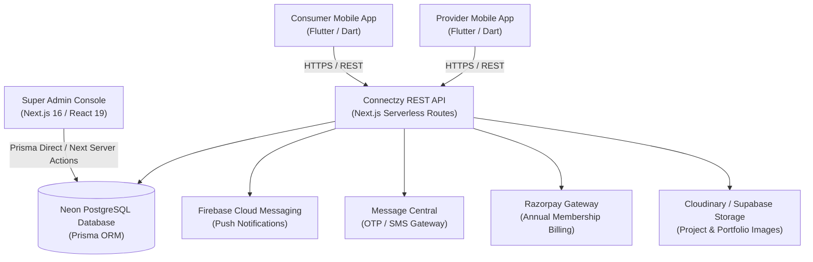
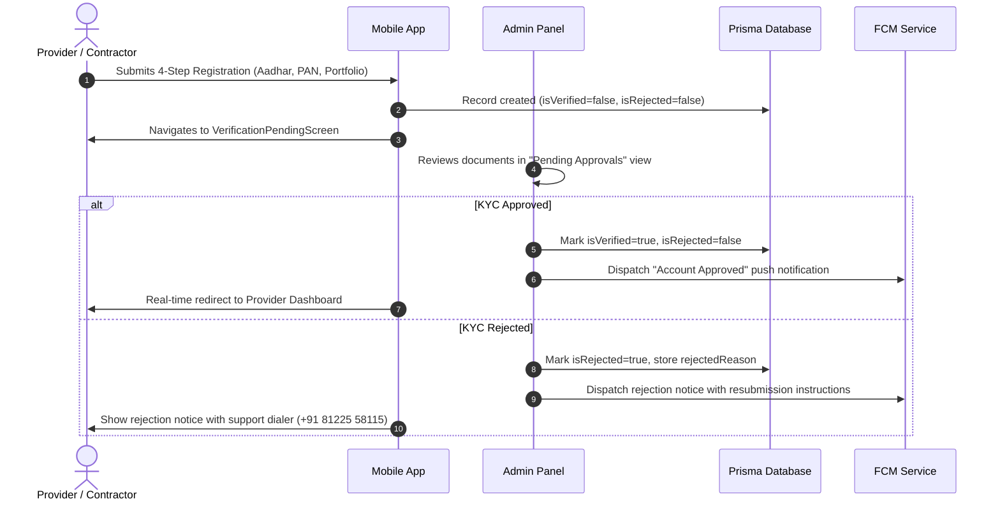
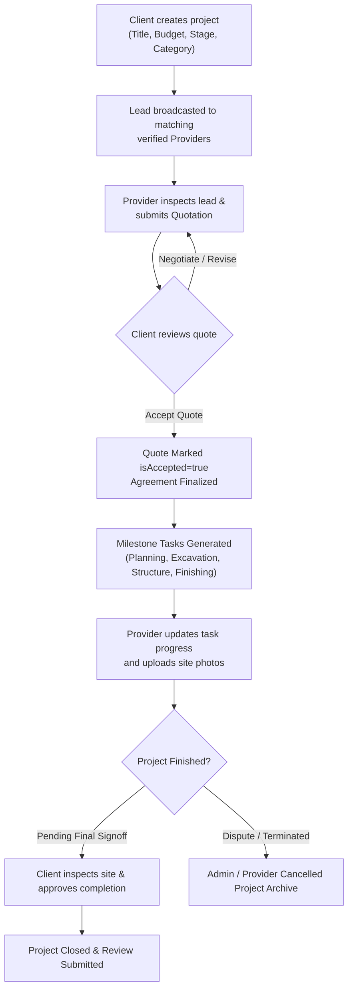
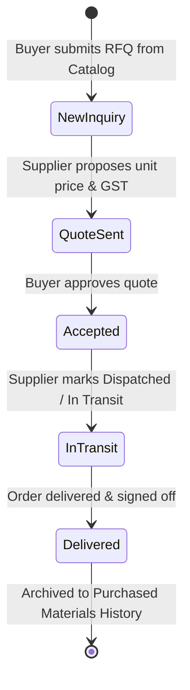

# Connectzy Platform — Standard Operating Procedure (SOP) Manual
**Document ID:** SOP-CONNECTZY-2026-V1  
**Platform Version:** App v1.0.2 (Build 6) | Admin Panel v0.1.0  
**Effective Date:** November 2026  
**Audience:** Platform Administrators, Operations Team, Technical Leads, Customer Support, and Onboarding Officers

---

## 1. Document Purpose & Scope

This Standard Operating Procedure (SOP) manual defines the official operational, technical, and governance workflows for the **Connectzy Platform** (comprising the Flutter Android/iOS Mobile Application, the Next.js Web Administration Panel, and the PostgreSQL Backend Database). 

It ensures standardized execution across:
* User and service provider verification, compliance, and lifecycle administration.
* Project creation, bidding, milestones, and dispute handling.
* B2B material procurement, delivery tracking, and purchase ledger maintenance.
* Financial profit tracking, platform commissions, and subscription management.
* Production application building, signing, and Google Play Store deployment.

---

## 2. Platform Architecture & Technical Stack



### Core Technology Stack Summary:
* **Mobile Client:** Flutter SDK 3.47.x / Dart 3.13.x (Clean Riverpod state management, GoRouter, Shimmer, ImagePicker).
* **Admin Web & API Engine:** Next.js 16.2.4 (TypeScript, Tailwind CSS v4, Lucide Icons).
* **Database & ORM:** PostgreSQL on Neon Serverless with Prisma ORM 6.19.x.
* **Push Notifications:** Firebase Cloud Messaging (FCM) with automated HTTP v1 OAuth2 dispatch.
* **Authentication & OTP:** Message Central SMS API (Transactional OTP) & Google OAuth 2.0.
* **Payment Processing:** Razorpay PG (Order creation, signature verification, webhook capture).
* **Support Contact:** Phone: `+91 81225 58115` | Email: `notification.aatzytechnologies@gmail.com`.

---

## 3. Role & Permission Matrix

| Role | Access Scope | Capabilities | Restrictions |
| :--- | :--- | :--- | :--- |
| **Consumer (Client)** | Mobile App | Post construction projects, request quotations, negotiate B2B materials, track delivered purchases, rate providers. | Cannot access provider leads console or admin analytics. |
| **Provider (Contractor)** | Mobile App | View incoming project leads, submit quotations, update project tasks/stages, upload portfolio, manage subscription. | Requires verified KYC approval before leads and chat unlock. |
| **Supplier (Vendor)** | Mobile App | Add B2B products (raw materials, LED walls), quote prices, update dispatch & delivery stages, monitor sales volume. | Restricted to procurement transactions and material inquiries. |
| **Super Admin** | Web Console | Approve/reject providers, toggle account active/inactive states, monitor profit analytics, grant subscriptions, manage ads. | Master operational authority. |

---

## 4. Operational Standard Operating Procedures

### SOP-01: Provider Onboarding, KYC Verification & Account Moderation

#### Purpose:
To ensure only legitimate, background-checked civil contractors, architects, engineers, and suppliers operate on Connectzy.



#### Detailed Step-by-Step Procedure:
1. **Application Intake:** Provider registers via the 4-step mobile stepper (`category`, `businessName`, `experience`, `aadharCard`, `panCard`, `portfolioImages`).
2. **Review Queue:** Admin accesses **Admin Console $\rightarrow$ Provider Approvals Pending** (`/admin?view=pending`).
3. **Document Verification:**
   * Verify Aadhar card name matches `ownerName`.
   * Verify PAN format and business validity.
   * Inspect portfolio images to verify authentic past civil/interior works.
4. **Approval Action:**
   * Click **Approve Provider**. The backend updates `isVerified: true` and triggers a real-time FCM notification.
5. **Rejection Action:**
   * If fraudulent or blurry, click **Reject Provider**, provide specific notes (e.g., *"PAN card image unreadable"*).
6. **Account Deactivation (Active $\rightarrow$ Inactive Toggle):**
   * If a live provider engages in unprofessional conduct, Admin clicks the Status toggle on **Approved Providers** list.
   * The server updates `isVerified: false`.
   * The app's real-time heartbeat (15-second polling + FCM push) immediately intercepts the session and redirects the provider back to `VerificationPendingScreen`.

---

### SOP-02: Project Creation, Bidding & Milestone Execution

#### Purpose:
To govern the execution of client construction projects from cost estimation to final handover.



#### Detailed Step-by-Step Procedure:
1. **Project Initiation:** Client creates a project via `/create-project` selecting category (e.g., *Builder/General Contractor*, *Interiors*, *LED Walls & Digital Displays*).
2. **Quotation Submission:** Verified providers in the matched service category view the job lead and submit estimated rate, timeline, and deliverables.
3. **Quotation Acceptance:** Client reviews bids and taps **Accept Quotation**. Status locks with that provider, creating an active contract.
4. **Milestone Tracking:**
   * Provider adds tasks (`ProjectTask`) in Provider Job Detail console.
   * As tasks transition (`Not Started` $\rightarrow$ `In Progress` $\rightarrow$ `Completed`), project progress bar automatically recalculates.
5. **Project Completion:** When all tasks reach 100%, provider triggers **Request Completion Approval**. Once confirmed by consumer, project is marked `Completed`.

---

### SOP-03: B2B Materials Procurement & Purchase Ledger

#### Purpose:
To manage bulk raw material sourcing (Cement, Steel Rebars, Paints, Electrical, LED Screens) between consumers/builders and suppliers.



#### Detailed Step-by-Step Procedure:
1. **Catalog Maintenance:** Suppliers upload catalog inventory via `/supplier-product-management` specifying:
   * Item name, Marketplace Category (e.g., *Materials & Supply*, *LED Walls & Digital Displays*).
   * Unit rate (`pricePerUnit`), Unit type (`Bag`, `Ton`, `Piece`, `Sq Ft`), and Cost Price (`costPrice`).
2. **Buyer RFQ (Request for Quote):** Consumer browses `/b2b-products`, enters quantity and site delivery coordinates.
3. **Quotation Negotiation:** Supplier reviews lead under `/b2b-materials` (Tab 0: *Quotes / Inquiries*), inputs unit price and GST percentage (5%, 12%, 18%, 28%).
4. **Order Execution (In Transit):** When accepted, the deal moves to Tab 1 (*In Transit*). Supplier updates tracking notes and vehicle details.
5. **Delivery Completion:**
   * Upon physical receipt, supplier flags delivery status as `Delivered` and marks deal as `Closed`.
   * Order automatically moves to Tab 2: **Purchased Materials History**.
6. **Consumer History Verification:**
   * Consumer can review all completed procurement orders, quantities, unit prices, and supplier badges at `/b2b-materials?tab=2` or via **Profile $\rightarrow$ Purchased Materials History**.

---

### SOP-04: Admin Financial Analytics & Profit Reconciliation

#### Purpose:
To audit platform gross merchandise value (GMV), supplier account revenues, and net platform profit margins.

#### Detailed Step-by-Step Procedure:
1. **Accessing Analytics:** Log in to Admin Console $\rightarrow$ Dashboard $\rightarrow$ **Earnings & Profits**.
2. **Reviewing Service Project Billings:**
   * Select **Service Project Profits** to inspect total billing from accepted contractor quotations.
   * Filter contractor accounts by time range (`Day`, `Month`, `Year`) to evaluate top-performing builders.
3. **Reviewing Material Order Profits:**
   * Select **Material Profits (By Account)**.
   * Review consolidated KPIs:
     * **Total Material Sales:** Total gross transactional billing across all material orders.
     * **Material Net Profit:** Calculated profit from COGS spread (`Total Revenue - Total Cost`) or baseline platform commission.
     * **Delivered Orders & Supplier Accounts Count.**
4. **Account-Level Reconciliation:**
   * Click any supplier in the **Supplier Accounts Leaderboard** to filter all transactions specifically for that account.
   * Verify individual itemized records (Buyer, Quantity, Unit Rate, Order Total, Net Profit, and Delivery Status).

---

### SOP-05: Provider Membership Subscriptions (Razorpay)

#### Purpose:
To administer the annual provider membership fee of ₹5,999/year.

#### Operational Rules:
1. **Automatic Subscription via Mobile App:**
   * Provider initiates subscription in profile screen $\rightarrow$ Razorpay modal opens.
   * On successful transaction, `/api/subscription/verify-payment` verifies the Razorpay signature (`razorpay_signature`), updates `subscriptionStatus: ACTIVE`, and sets `subscriptionExpiresAt` to 365 days in future.
2. **Manual Subscription Granting (Admin Console):**
   * If a provider pays via offline NEFT/RTGS or promotional waiver:
   * Admin navigates to **Subscription Management** (`/admin?view=subscriptions`).
   * Selects provider, specifies duration in days (e.g. 365), and clicks **Grant Subscription**.
   * Backend writes an active subscription record and updates provider profile immediately.

---

## 5. Technical SOP: Build, Versioning & Release Management

### SOP-06: Generating Production Android App Bundle (.aab)

#### Pre-requisite Checklist:
* **JDK:** Microsoft OpenJDK 17 installed at `C:\Program Files\Microsoft\jdk-17.0.21.21-hotspot`.
* **Android SDK Command-Line Tools:** Installed at `C:\Users\massa\AppData\Local\Android\sdk\cmdline-tools\latest`.
* **Keystore:** `android/key.properties` present with valid alias, storeFile, and passwords.
* **Gradle Properties:** `org.gradle.java.home` pinned to JDK 17 in `android/gradle.properties`.

#### Step-by-Step Build Execution:
1. **Check Code Health:**
   ```powershell
   & "C:\Users\massa\flutter\bin\flutter.bat" analyze
   ```
   *Must report: `No issues found!`*

2. **Increment App Version in `pubspec.yaml`:**
   * Update line 19 of `pubspec.yaml`:
     ```yaml
     version: 1.0.X+Y
     ```
     *(Where `X` is semantic version and `Y` is strictly increasing versionCode e.g., `1.0.2+6`).*

3. **Execute Production Bundle Build:**
   ```powershell
   & "C:\Users\massa\flutter\bin\flutter.bat" build appbundle --release
   ```

4. **Verify Output Artifact:**
   * Confirm file generated at: `D:\construction app\build\app\outputs\bundle\release\app-release.aab`.
   * Expected bundle size: 70MB – 75MB.

---

### SOP-07: Google Play Console Submission & Compliance

#### Step-by-Step Procedure:
1. Open [Google Play Console](https://play.google.com/console) $\rightarrow$ Select **Connectzy** application.
2. **Manage Releases:** Navigate to **Production** $\rightarrow$ **Create New Release**.
3. **Upload AAB:** Upload `build/app/outputs/bundle/release/app-release.aab`.
4. **Enter Release Notes:**
   ```text
   What's New in Version 1.0.2:
   • LED Walls & Digital Displays: Discover and hire verified LED display and screen specialists directly from the Marketplace.
   • Real-time Service Search: Quickly find 50+ construction & specialty services with our instant search and filter tags.
   • Purchased Materials History: Track your past delivered material orders, receipts, and order statuses directly in your Account.
   • Performance & Stability: Enhanced order tracking, faster screen transitions, and bug fixes across all workflows.
   ```
5. **App-Level Declarations Compliance:**
   * In Policy & Compliance section, ensure **Trader Status Declaration** is answered:
     * Select: *"Yes, my trader status applies to this app"* (required under EU Digital Services Act for commercial marketplaces).
6. **Rollout:** Tap **Review Release** $\rightarrow$ **Start Rollout to Production**.

---

## 6. Incident Management & Support Protocols

### Escalation Matrix:

| Severity | Incident Type | Primary Responder | Target Resolution | Escalation Action |
| :--- | :--- | :--- | :--- | :--- |
| **P1 - Critical** | Database down, API 500 error, payment capture failure. | Backend Lead / Admin | < 1 Hour | Check Neon DB health, verify Vercel server logs, check Razorpay webhook logs. |
| **P2 - High** | Provider deactivation not syncing, FCM notifications delayed. | Mobile Engineer | < 3 Hours | Verify FCM Service Account token, restart mobile daemon, test push API route. |
| **P3 - Medium** | Incorrect quotation calculations, profile photo upload failure. | Frontend Engineer | < 8 Hours | Check storage quota, verify input sanitization regex. |
| **P4 - Low** | UI alignment, text labeling feedback, search ranking tweak. | UI/UX Developer | < 24 Hours | Incorporate in regular bi-weekly sprint release. |

### Emergency Support Helpline:
* **Official Hotline:** `+91 81225 58115`
* **Admin Verification Dispatch:** `9994229553`
* **Official Email:** `notification.aatzytechnologies@gmail.com`

---
*End of Standard Operating Procedure Document.*
